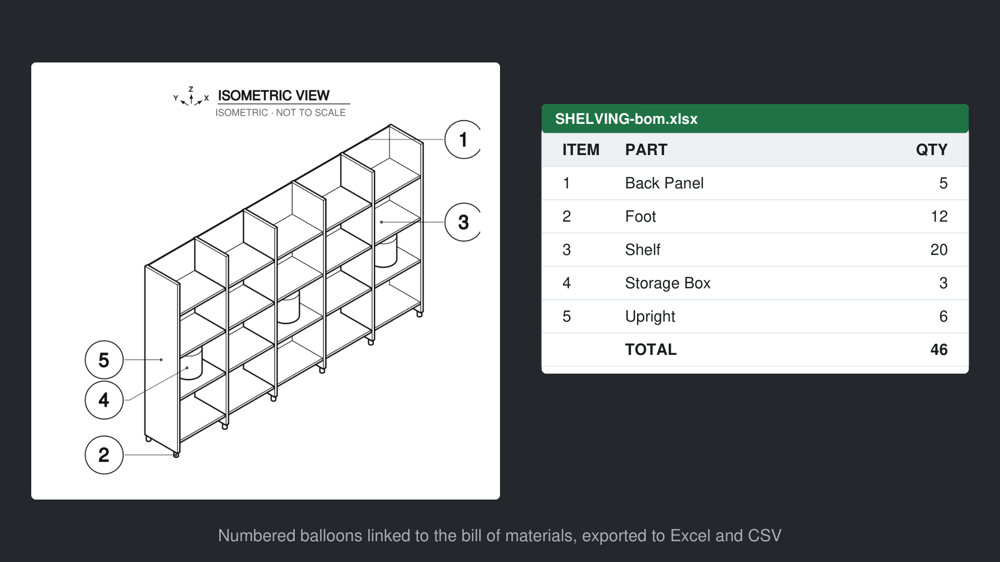

# BOM to CSV and Excel

Panel **Bill of Materials** ‣ **BOM to CSV / Excel**. Next to the drawing: `<number>-bom.csv` and `<number>-bom.xlsx`.

- Headers in the drawing language, a total row, and a **Sheet** column when there are several sheets.
- Each row counted once, even when the bill of materials is shown on several sheets.
- The [[custom columns|Custom-BOM-Columns]] are exported too.
- Bill of Materials ‣ **Count by** must not be None.

