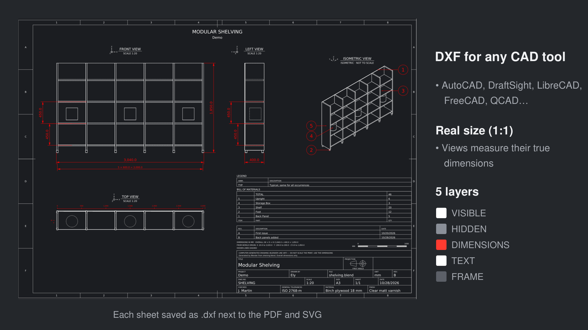
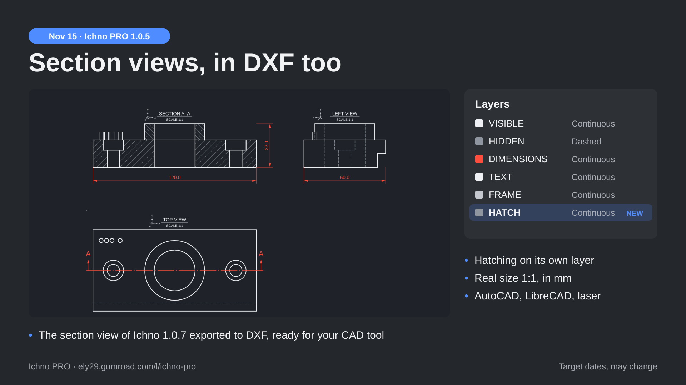

# DXF export

Panel **Output** ‣ **DXF**. Each sheet is also saved as a DXF file (AutoCAD R12), next to the PDF and the SVG.

- **Layers:** VISIBLE, HIDDEN (dashed), DIMENSIONS, TEXT, FRAME and **HATCH** (section views).
- **Real Size (1:1)**, on by default: the views measure their true dimensions in the CAD tool, in millimetres. Off: paper millimetres, like the PDF.
- **Section views:** the hatching is on its own HATCH layer, at real size; the cutting planes page is one more DXF sheet.
- A bill of materials on a separate sheet becomes one more DXF file.

**Opening the DXF in Blender:** Blender's own DXF import does not scale texts. Import at scale 1, then scale everything by 0.001.
