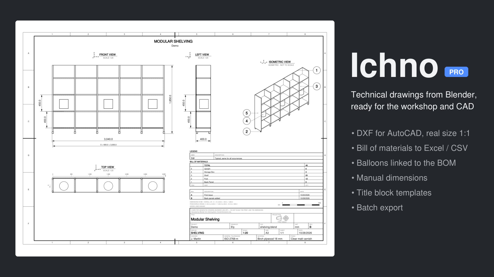

# Ichno PRO

**Ichno PRO** is the extended edition of [Ichno](https://extensions.blender.org/add-ons/ichno/), the Blender add-on that turns a scene
into a technical drawing in one click. It contains every feature of the free edition and adds the tools you need to send a drawing
to a workshop or a CAD tool. Each PRO feature sits in the panel where it belongs.

| Page | What it does | Panel |
|---|---|---|
| [[DXF export\|DXF-Export]] | One DXF per sheet, real size 1:1, layers, hatched sections | Output |
| [[BOM to CSV and Excel\|BOM-Files]] | The bill of materials as `.csv` and `.xlsx` | Bill of Materials |
| [[Custom BOM columns\|Custom-BOM-Columns]] | Material, size, position, collection or any property | Bill of Materials |
| [[Balloons]] | Numbered balloons linked to the bill of materials (ISO 6433) | Bill of Materials |
| [[Manual dimensions\|Manual-Dimensions]] | Between two vertices or two positions of the 3D cursor | Dimensions |
| [[Title block templates\|Title-Block-Templates]] | Company settings saved, exported and imported | Templates |
| [[Batch export\|Batch-Export]] | Every scene of a file, or every .blend of a folder | Batch Export |

Everything shared with the free edition (views, section views, sheets, title block, dimensions, bill of materials) is documented in the
[Ichno wiki](https://github.com/Elyh29/ichno/wiki).

Right-click any PRO setting ‣ **Online Manual** (F1) opens its page here.

**Get Ichno PRO:** https://ely29.gumroad.com/l/ichno-pro · Bugs and ideas: [issues](https://github.com/Elyh29/ichno-pro/issues)
