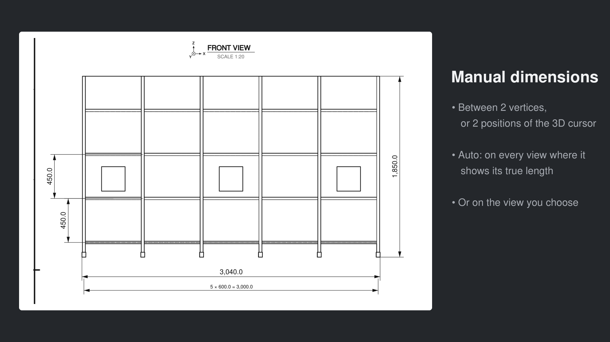

# Manual dimensions

Panel **Dimensions** ‣ **Manual Dimensions**. Dimensions you choose, added to the overall dimensions.

1. **From 2 Vertices:** select two vertices in Edit Mode, click the button.
2. **From 3D Cursor:** place the 3D cursor on the first point, click; move it to the second point, click again.
3. **View:** Auto draws the true length; Front, Side or Top draws the distance seen in that plane.
4. **Name** is your own note (not drawn); **Remove Dimension** deletes the selected one.

Vertical dimensions get their own room left of the view: their value never leaves the frame.

