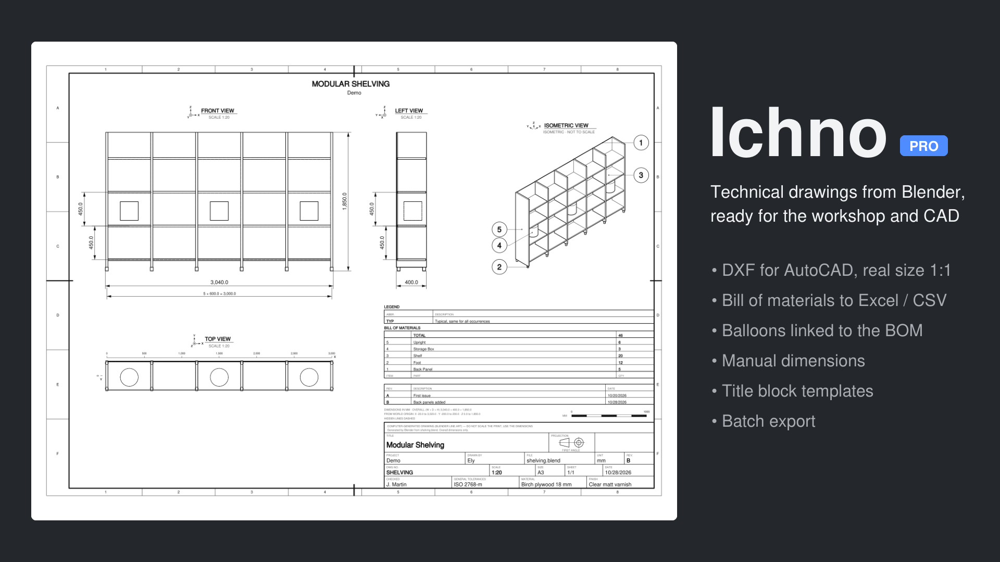
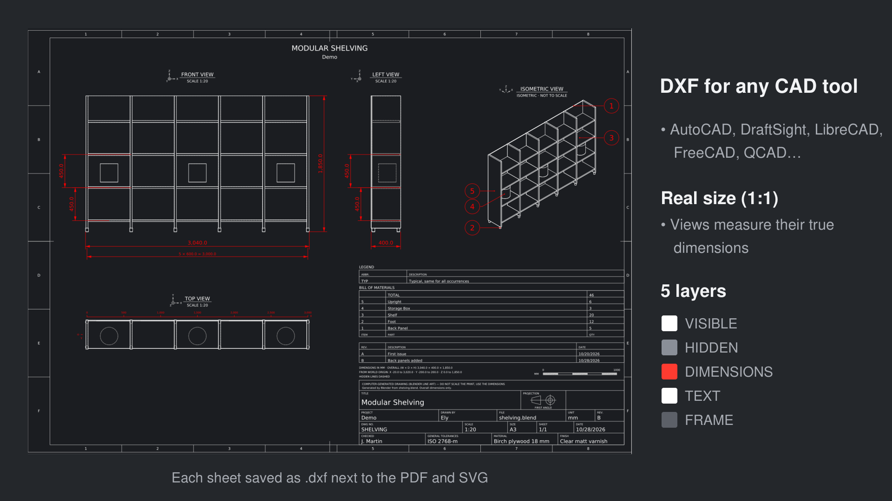
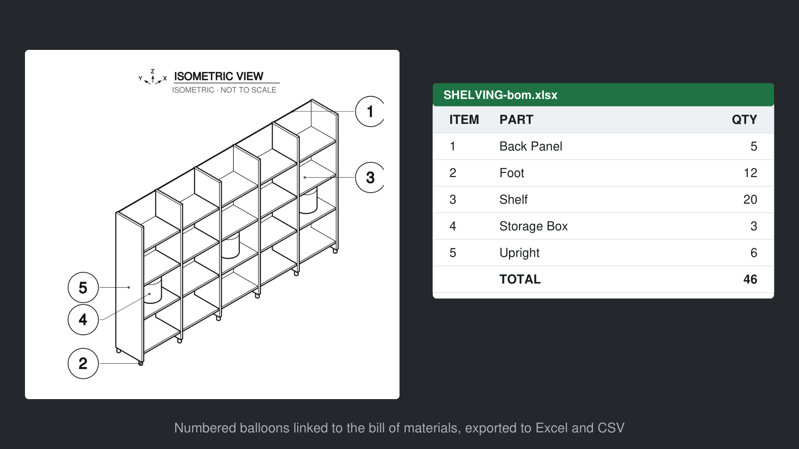
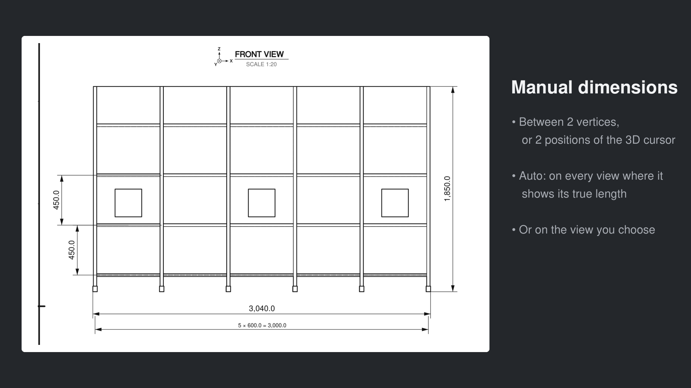
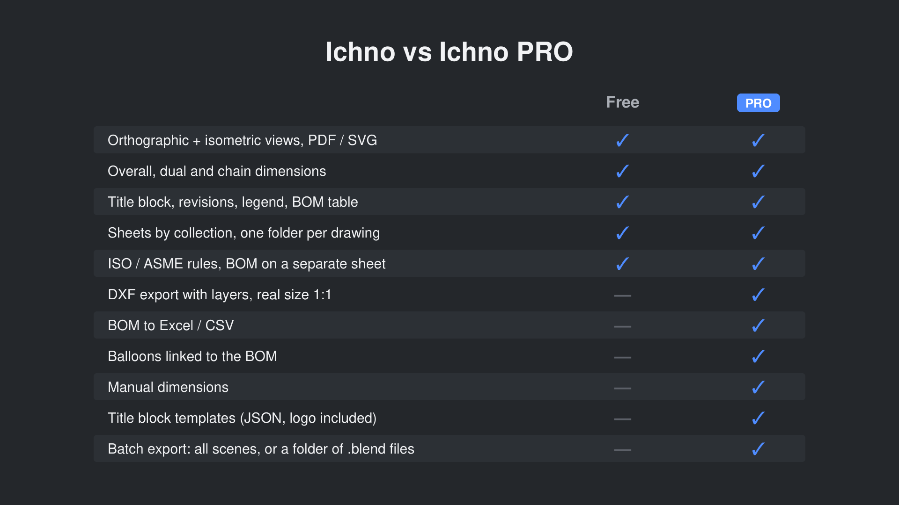
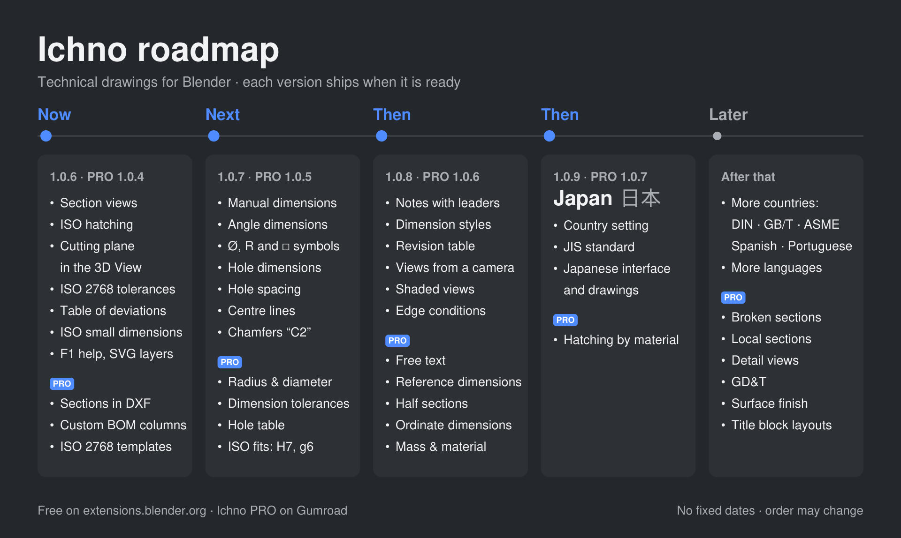

# Ichno PRO

**Ichno PRO** is the extended edition of [Ichno](https://extensions.blender.org/add-ons/ichno/), the Blender add-on that turns a scene into a technical drawing in one click. It contains every feature of the free edition and adds:

- **DXF export**: one file per sheet (AutoCAD R12), layers VISIBLE, HIDDEN, DIMENSIONS, TEXT, FRAME and HATCH (section views), real size 1:1 in millimetres
- **Bill of materials to CSV and Excel**, with headers in the drawing language and a total row
- **Custom BOM columns**: material, size, position, collection or any custom property
- **Balloons** linked to the bill of materials (ISO 6433), in columns or rows, with optional straight leaders
- **Manual dimensions** between two vertices or two positions of the 3D cursor
- **Title block templates**: company, logo, fields, sheet settings and ISO 2768 tolerances saved under a name, exported and imported as JSON
- **Batch export**: every scene of a file, or every .blend of a folder

**Get Ichno PRO:** https://ely29.gumroad.com/l/ichno-pro

> This repository holds the issue tracker, the release notes and the documentation of Ichno PRO. The add-on itself is delivered through Gumroad.

## Install
1. Disable the free Ichno if it is installed (one edition at a time).
2. Blender ‣ Edit ‣ Preferences ‣ Add-ons ‣ ⌄ ‣ **Install from Disk**, then pick the `ichno_pro-x.y.z.zip` file.
3. The **Ichno** tab appears in the 3D Viewport sidebar (N).

Blender 4.3 or newer (tested up to 5.2). Windows, macOS and Linux.

## Documentation
- [Ichno PRO wiki](https://github.com/Elyh29/ichno-pro/wiki): DXF, BOM files and columns, balloons, manual dimensions, templates, batch export
- Everything shared with the free edition (views, sheets, title block, dimensions, bill of materials): [Ichno wiki](https://github.com/Elyh29/ichno/wiki)

## Screenshots
| | |
|---|---|
|  |  |
|  |  |

## What's next
Each version ships **when it's ready**, free and PRO together; no fixed dates, the order may change.

- **Next:** manual and angle dimensions, Ø, R and □ symbols, hole dimensions, centre lines, chamfers · PRO: radius and diameter, dimension tolerances, hole table, ISO fits (H7, g6)
- **Then:** notes with leaders, dimension styles, views from a camera, shaded views, material colours · PRO: free text, reference dimensions, half sections, ordinate dimensions, finishes in the bill of materials
- **Then:** country setting and the Japan update (JIS, Japanese interface and drawings) · PRO: hatching by material
- **Later:** more countries and languages · PRO: broken and local sections, detail views, GD&T and surface finish

Missing something for your drawings? Open a [feature request](../../issues/new/choose).

## Release notes
See [CHANGELOG.md](CHANGELOG.md).

## Support
- **Bug or idea:** open an [issue](../../issues/new/choose).
- **Purchase, licence or download:** reply to your Gumroad receipt.
