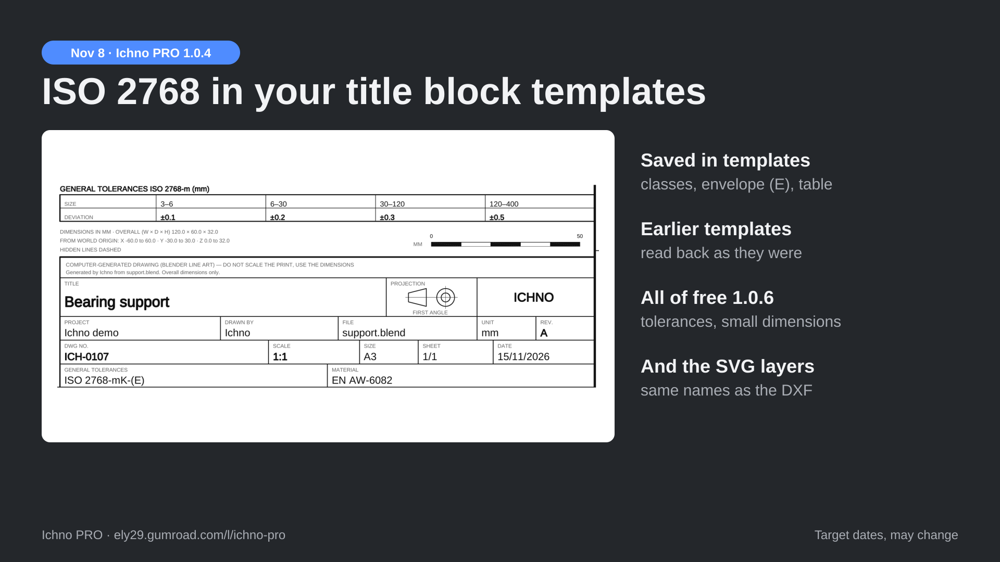

# Title block templates

Panel **Templates**. Save your company settings under a name and reuse them in every file.

- Saved: company, logo, author, ownership notice, custom fields, legend, sheet settings, standard, filing margin, view titles,
  Checked, Approved, material and **tolerances** (ISO 2768 classes, envelope (E) and the table of deviations).
- **Apply**, **Delete**, **Export** or **Import**: one JSON file, logo included, to share with your team.
- Templates from earlier versions (« ISO 2768-mK ») are read and converted.

